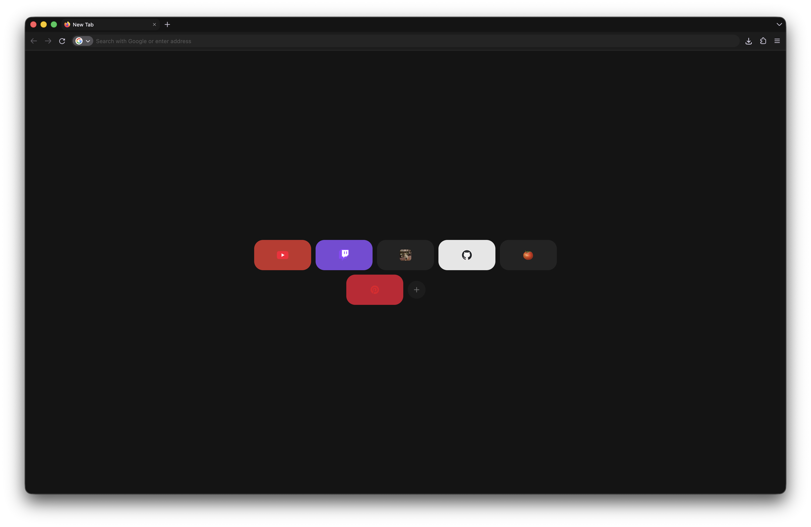

# katsera theme for Firefox

Спокойная тёмная тема для Firefox: графитовые цвета без чистого чёрного, компактные вкладки, одна строка с адресом и новая вкладка только с ярлыками-плитками.



## Установка (macOS)

```bash
git clone https://github.com/<user>/katserathemefirefox.git
cd katserathemefirefox
./install.sh
```

Скрипт создаёт отдельный профиль Firefox `Calm` и кладёт в него тему. Запуск:

```bash
/Applications/Firefox.app/Contents/MacOS/firefox -P Calm --no-remote
```

### Вручную (любая ОС)

1. Открой `about:profiles` и найди папку нужного профиля (Root Directory).
2. Скопируй туда `user.js` и папку `chrome/`.
3. Перезапусти Firefox.

## Файлы

| Файл | Что делает |
| --- | --- |
| `chrome/userChrome.css` | интерфейс: вкладки, адресная строка, меню |
| `chrome/userContent.css` | новая вкладка: плитки, `+`, меню ⋯ |
| `user.js` | настройки: включает CSS, тёмную тему, компактный режим |
| `install.sh` | создаёт профиль `Calm` и копирует тему |

## Настройка

Цвета интерфейса заданы переменными в начале `userChrome.css`, цвета плиток — в конце `userContent.css`. После изменений запусти `./install.sh` и перезапусти Firefox.
